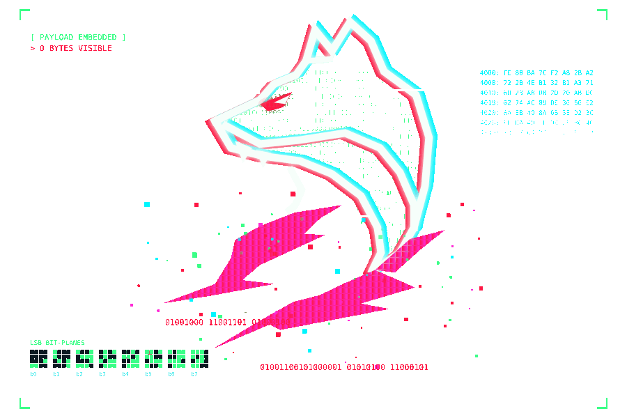

<div align="center">



# ValiCrypt
### Precision Security for Modern Media • Zero-Knowledge Steganographic Carrier Platform

[](LICENSE)
[](https://www.python.org/)
[](https://react.dev/)
[](https://fastapi.tiangolo.com/)
[]()
[](https://render.com)

<p align="center">
  <b>Conceal authenticated, AES-256-GCM encrypted ZIP archives and secret Unicode text inside lossless images and video containers using RFC 9106 Argon2id.</b>
</p>

</div>

**ValiCrypt** is a production-grade, zero-knowledge steganographic carrier security platform. It empowers users to securely conceal an **authenticated, encrypted ZIP archive or secret Unicode text message inside an image or video carrier**, and later recover it using the correct password.

The embedded payload is **never** stored as plaintext. ValiCrypt fuses **Argon2id (RFC 9106)** memory-hard key derivation with **AES-256-GCM (NIST SP 800-38D)** authenticated encryption, binding all structural metadata into Associated Authenticated Data (AAD) before lossless steganographic embedding into carrier media.

---

## Table of Contents

1. [Overview & Core Objectives](#1-overview)
2. [Features & Capabilities](#2-features)
3. [Architecture & Protocol Envelope](#3-architecture)
4. [Technology Stack](#4-technology-stack)
5. [Installation & Setup](#5-installation)
6. [Running Locally](#6-running-locally)
7. [Deploying to Render](#7-deploying-to-render)
8. [Docker & Containerized Setup](#8-docker-setup)
9. [Usage & Workflows](#9-usage)
10. [Image Steganography Engine](#10-image-steganography)
11. [Video Steganography Engine](#11-video-steganography)
12. [Cryptographic Architecture](#12-cryptographic-architecture)
13. [Security & Threat Model](#13-security-model)
14. [ValiCrypt CLI Reference](#14-cli-reference)
15. [API Documentation](#15-api-documentation)
16. [SEO, GEO & Metadata](#16-seo-geo-metadata)
17. [Testing & Quality Assurance](#17-testing)
18. [Project Structure](#18-project-structure)
19. [License & Credits](#19-license)

---

## 1. Overview <a name="1-overview"></a>

ValiCrypt implements two primary end-to-end workflows with **instant auto-download** and **zero lingering history**:

### Workflow A — HIDE
```text
User Selects Media Carrier (Image / Video)
              │
User Selects Payload (ZIP Archive or Unicode Text)
              │
User Inputs Secret Passphrase
              │
              ▼
Argon2id Key Derivation (64 MiB Memory, 2 Iterations, 16-byte Salt)
              │
              ▼
AES-256-GCM Authenticated Encryption (Fresh 96-bit Nonce, 128-bit Tag)
              │
              ▼
Self-Contained 92-byte Binary Envelope (Versioned, AAD-bound)
              │
              ▼
Steganographic Embedding (Lossless LSB or ISO-BMFF / MKV Stream)
              │
              ▼
Instant Client Auto-Download of Encoded Carrier
```

### Workflow B — EXTRACT
```text
Encoded Carrier Media Uploaded
         │
         ▼
Detect ValiCrypt Preamble & Envelope
         │
         ▼
Extract Encrypted Payload
         │
         ▼
User Enters Passphrase
         │
         ▼
Argon2id Key Derivation
         │
         ▼
AES-256-GCM Decryption & Tag Verification
         │
         ▼
SHA-256 Plaintext Hash Integrity Check
         │
         ▼
Instant Client Auto-Download of Recovered Payload (ZIP or Text)
```

---

## 2. Features & Capabilities <a name="2-features"></a>

- **RFC 9106 Argon2id Key Derivation**: Configured with 64 MiB memory cost, 2 iterations, and 4 parallel lanes to thwart GPU and ASIC dictionary attacks.
- **AES-256-GCM Authenticated Encryption**: Fresh cryptographically secure 96-bit random nonce generated for every operation; 16-byte GMAC authentication tag guarantees tamper detection.
- **Associated Authenticated Data (AAD)**: 92-byte binary header (magic bytes, version, payload type, salt, nonce, payload lengths, original plaintext SHA-256) is authenticated cryptographically; any tampering aborts decryption before decompression.
- **Lossless Image Steganography**: Vectorized NumPy Least Significant Bit (LSB) embedding across RGB channels (PNG, BMP, TIFF) preserving alpha channels without visual artifacts.
- **Lossless Video Steganography**: Embeds payloads into ISO/IEC 14496-12 custom UUID atoms in MP4 containers without transcoding, preserving 100% video/audio playback fidelity.
- **Instant Auto-Download**: Encoded carriers and recovered payloads trigger automatic browser file downloads upon completion.
- **Zero Lingering History**: Ephemeral server processing; only up-to-date transient metadata is stored in SQLite, and temporary files are pruned automatically.
- **Responsive Cyberpunk UI**: Built with React 18, Vite, and Tailwind CSS; fluid responsive layouts tested down to 320px mobile screens with zero horizontal jitter.
- **Production-Ready Render Deployment**: Native `render.yaml` Blueprint and multi-stage Dockerfile evaluating dynamic `$PORT` binding and `/health` probes.

---

## 3. Architecture & Protocol Envelope <a name="3-architecture"></a>

ValiCrypt wraps encrypted data in a strict 92-byte binary header (`MV01`):

```text
+-----------------------+---------+----------------------------------------------+
| Field                 | Size    | Description                                  |
+-----------------------+---------+----------------------------------------------+
| Magic Bytes           | 4 B     | b"MV01"                                      |
| Version               | 2 B     | uint16 (Big-Endian, currently 1)             |
| Payload Type          | 2 B     | uint16 (1 = ZIP Archive, 2 = Text Message)   |
| Argon2id Salt         | 16 B    | Cryptographically secure random salt         |
| AES-GCM Nonce         | 12 B    | Cryptographically secure random 96-bit nonce |
| Ciphertext Length     | 4 B     | uint32 (Big-Endian, size of encrypted bytes) |
| Plaintext Length      | 4 B     | uint32 (Big-Endian, uncompressed size)       |
| Plaintext SHA-256     | 32 B    | SHA-256 hash of original unencrypted payload |
| Reserved Padding      | 16 B    | Zeroed bytes reserved for future extensions  |
+-----------------------+---------+----------------------------------------------+
| TOTAL HEADER SIZE     | 92 B    | Cryptographically bound as AAD               |
+-----------------------+---------+----------------------------------------------+
| Ciphertext Payload    | N B     | AES-256-GCM encrypted data                   |
| GMAC Auth Tag         | 16 B    | GCM authentication tag                       |
+-----------------------+---------+----------------------------------------------+
```

---

## 4. Technology Stack <a name="4-technology-stack"></a>

| Component | Technology | Purpose |
|---|---|---|
| **Frontend** | React 18, TypeScript, Vite, Tailwind CSS, Lucide | Responsive, accessible UI with slot-reel Glyph Lottery |
| **Backend** | Python 3.11+, FastAPI, Pydantic v2, Uvicorn | Async REST API, security headers, file stream handling |
| **Cryptography** | Argon2-cffi, Cryptography (AES-256-GCM) | RFC 9106 KDF & authenticated encryption |
| **Media Engines** | NumPy, Pillow, FFmpeg, FFprobe | Lossless LSB bit planes & ISO-BMFF UUID atom handling |
| **Database** | SQLite via SQLAlchemy | Pruned job metadata (zero plaintext/secret storage) |
| **Deployment** | Docker, Render Blueprint (`render.yaml`) | Multi-stage production container with dynamic port binding |

---

## 5. Installation & Setup <a name="5-installation"></a>

### Prerequisites
- Python 3.11 or newer
- Node.js 18+ and npm
- FFmpeg and FFprobe (available in system PATH or `bin/`)

### Clone & Install
```bash
git clone https://github.com/ark/valicrypt.git
cd valicrypt

# Install backend dependencies
pip install -r backend/requirements.txt

# Install frontend dependencies
cd frontend && npm install && cd ..
```

---

## 6. Running Locally <a name="6-running-locally"></a>

### Option 1: Full-Stack Production Mode
Builds the frontend SPA and serves everything through FastAPI:
```bash
make run
# Or:
npm --prefix frontend run build
./scripts/run_backend.sh
```
Open **`http://localhost:8000`** in your browser.

### Option 2: Development Mode (Hot Reloading)
In Terminal 1 (Backend):
```bash
make run-backend
# Runs FastAPI on http://localhost:8000 with reload
```

In Terminal 2 (Frontend):
```bash
make run-frontend
# Runs Vite dev server on http://localhost:5173 with HMR
```

---

## 7. Deploying to Render <a name="7-deploying-to-render"></a>

ValiCrypt is configured out-of-the-box for seamless deployment to **Render** using either Docker or Blueprints.

### Method A: Blueprint Deployment (One-Click)
1. Fork or push this repository to your GitHub account.
2. In the [Render Dashboard](https://dashboard.render.com/), click **New +** -> **Blueprint**.
3. Connect your repository. Render detects [`render.yaml`](render.yaml) automatically:
   - Sets runtime to **Docker**
   - Configures Health Check to `/health`
   - Binds dynamically to `${PORT}`
4. Click **Apply**. Render builds the multi-stage Dockerfile and deploys the service.

### Method B: Manual Docker Web Service
1. Click **New +** -> **Web Service**.
2. Select **Docker** as the Environment.
3. Set the Health Check Path to:
   ```text
   /health
   ```
4. Set Environment Variables:
   - `PROJECT_NAME`: `ValiCrypt`
   - `ENVIRONMENT`: `production`
   - `DEBUG`: `false`
   - `DATABASE_URL`: `sqlite:////tmp/valicrypt.db`
5. Click **Create Web Service**.

---

## 8. Docker Setup <a name="8-docker-setup"></a>

Build and run the production container locally using Docker Compose:

```bash
# Build and run
docker compose up -d

# Check logs
docker compose logs -f

# Stop
docker compose down
```

The container exposes port `8000` (or `${PORT}`) and includes static FFmpeg binaries.

---

## 9. Usage & Workflows <a name="9-usage"></a>

### Workflow A: Hide Confidential Data
1. Navigate to **Hide Data**.
2. Upload a carrier image (`.png`, `.bmp`, `.tiff`) or video (`.mp4`, `.mov`, `.mkv`).
3. Select your payload type:
   - **Text**: Enter secret Unicode notes, credentials, or keys.
   - **ZIP Archive**: Upload confidential documents, directories, or code.
4. Input a strong password (Argon2id derivation will run).
5. Click **Encrypt & Embed Secret Payload**.
6. The encoded carrier is processed, verified, and **automatically downloaded** to your computer.

### Workflow B: Extract & Decrypt
1. Navigate to **Extract Data**.
2. Upload the encoded carrier file.
3. Enter the secret password used during encoding.
4. Click **Decrypt & Recover Payload**.
5. ValiCrypt extracts the ciphertext, derives the key, verifies the GMAC tag, and **automatically downloads** the recovered file or reveals the text.

### Workflow C: Verify Media Carrier
1. Navigate to **Verify Media**.
2. Upload any media carrier to inspect byte capacity, check for existing ValiCrypt steganographic envelopes, and verify FFprobe playback integrity.

---

## 10. Image Steganography Engine <a name="10-image-steganography"></a>

ValiCrypt employs a vectorized 2-bit-per-channel Least Significant Bit (LSB) embedding algorithm:

```python
# Available byte capacity in an RGB image
raw_capacity_bytes = (height * width * 3 * 2) // 8
payload_capacity_bytes = raw_capacity_bytes - 92  # Deduct 92-byte MV01 envelope
```

- **Alpha Channel Preservation**: When RGBA carriers are processed, only the RGB channels are modified. The alpha channel is copied untouched to prevent transparency artifacts.
- **Lossless Formats**: Supported carriers include PNG, BMP, and TIFF. Lossy formats (JPEG) are strictly rejected because discrete cosine transform (DCT) quantization destroys low-order bits.

---

## 11. Video Steganography Engine <a name="11-video-steganography"></a>

ValiCrypt hides encrypted payloads inside compliant video containers without re-encoding:

- **MP4 / MOV Containers**: Payloads are encapsulated inside an **ISO/IEC 14496-12 custom UUID box** (`uuid` atom) inserted at the container root. Standard video players (VLC, QuickTime, Chrome, Windows Media Player) safely ignore unknown UUID atoms and play the media smoothly.
- **Zero Loss / Zero Transcoding**: Because no video re-compression takes place, video and audio streams maintain 100% bit-exact fidelity.
- **MKV Containers**: Payloads are appended in a dedicated stream tag identified by the ValiCrypt signature.

---

## 12. Cryptographic Architecture <a name="12-cryptographic-architecture"></a>

| Step | Primitive | Configuration |
|---|---|---|
| **Passphrase Derivation** | Argon2id (RFC 9106) | Memory: 64 MiB (65536 KiB), Time: 2 iterations, Parallelism: 4 lanes, Salt: 16 CSPRNG bytes |
| **Symmetric Encryption** | AES-256-GCM (NIST SP 800-38D) | Key: 256 bits, Nonce: 96 CSPRNG bits, Auth Tag: 128 bits (GMAC) |
| **Authenticated Data** | Associated Authenticated Data (AAD) | All 92 bytes of the `MV01` header are fed into the GCM GMAC calculator |
| **Integrity Verification** | SHA-256 | Plaintext digest computed pre-encryption and verified post-decryption |

---

## 13. Security & Threat Model <a name="13-security-model"></a>

- **Tamper Evident**: Any modification to the carrier file, binary header, or ciphertext fails GCM authentication immediately with HTTP 401 / Safe Error.
- **Decompression Bomb Protection**: ZIP files are scanned before and after processing; archives with a compression ratio exceeding 100:1 or expanding beyond 100 MB are rejected.
- **Zip Slip Prevention**: Archives containing relative (`../`) or absolute path traversal sequences are blocked.
- **Zero Key Exposure**: Plaintext keys and passwords never touch disk or log outputs; logging sanitizers automatically redact sensitive fields.

---

## 14. ValiCrypt CLI Reference <a name="14-cli-reference"></a>

ValiCrypt includes a powerful CLI utility (`./bin/valicrypt`):

```bash
# Display help
./bin/valicrypt --help

# Check payload capacity of a carrier
./bin/valicrypt capacity -c examples/carriers/sample_carrier.png

# Hide a secret text message
./bin/valicrypt encode-text -c carrier.png -t "Confidential mission coordinates" -o stego.png

# Hide a ZIP archive inside a video
./bin/valicrypt encode -c video.mp4 -p secret.zip -o stego_video.mp4

# Decode and recover payload
./bin/valicrypt decode -c stego.png -o recovered/

# Verify carrier forensics
./bin/valicrypt verify -c stego.png
```

---

## 15. API Documentation <a name="15-api-documentation"></a>

Interactive Swagger UI and ReDoc are available when running the backend:
- Swagger Docs: `http://localhost:8000/docs`
- ReDoc: `http://localhost:8000/redoc`

### Key Endpoints
| Method | Path | Description |
|---|---|---|
| `GET` | `/health` | Root uptime and service health check (Render probe) |
| `GET` | `/api/v1/health` | Diagnostic health check with stego capabilities |
| `POST` | `/api/v1/capacity` | Calculate available byte capacity of a carrier |
| `POST` | `/api/v1/encode/text` | Embed encrypted text message into carrier |
| `POST` | `/api/v1/encode/zip` | Embed encrypted ZIP archive into carrier |
| `POST` | `/api/v1/decode` | Detect and recover payload from carrier |
| `POST` | `/api/v1/verify` | Forensically inspect carrier file |
| `GET` | `/api/v1/download/{token}/{name}`| Secure one-time file download |
| `GET` | `/robots.txt` | Crawler policy |
| `GET` | `/sitemap.xml` | Search engine index sitemap |

---

## 16. SEO, GEO & Metadata <a name="16-seo-geo-metadata"></a>

ValiCrypt is optimized for Generative Engine Optimization (GEO) and search indexers:
- **Canonical Tags & Open Graph**: Full metadata, Twitter large image cards, and canonical links.
- **JSON-LD Structured Data**: High-fidelity schemas for `SoftwareApplication`, `WebSite`, and `FAQPage`.
- **Search Engine Sitemaps**: Valid XML sitemap (`/sitemap.xml`) and crawler guidelines (`/robots.txt`).

---

## 17. Testing & Quality Assurance <a name="17-testing"></a>

ValiCrypt maintains a comprehensive 48-test automated test suite covering unit tests, security attack vectors, and end-to-end integration workflows.

Run all tests:
```bash
./scripts/run_tests.sh
# Or:
make test
```

### Verified Test Areas
- **Acceptance Tests**: Full roundtrips for PNG/BMP images and MP4 videos with text and ZIP archives.
- **Security Tests**: Path traversal (`..`), Zip Slip attacks, Zip Bombs, tampered carriers, and log sanitization.
- **Crypto Tests**: Wrong password rejection, tag corruption, salt/nonce uniqueness, Unicode support.
- **Steganography Tests**: Alpha preservation, image dimension boundaries, container UUID verification.

---

## 18. Project Structure <a name="18-project-structure"></a>

```text
valicrypt/
├── backend/
│   ├── app/
│   │   ├── api/routes/          # REST API route handlers
│   │   ├── core/                # Configuration, logging, errors
│   │   ├── crypto/              # Argon2id KDF, AES-256-GCM envelope
│   │   ├── db/                  # SQLite models and session management
│   │   ├── media/               # Image and video inspection engines
│   │   ├── services/            # Encode, decode, verify orchestration
│   │   ├── steganography/       # LSB image and UUID video encoders
│   │   └── main.py              # FastAPI application entrypoint
│   ├── cli/                     # ValiCrypt Click CLI
│   └── tests/                   # 48 unit, integration, and security tests
├── frontend/
│   ├── public/                  # Robots.txt, Sitemap.xml, Branding assets
│   ├── src/
│   │   ├── components/          # Cyber UI components (GlyphLottery, Capacity)
│   │   ├── pages/               # Dashboard, Hide, Extract, Verify, Config
│   │   └── services/            # Axios API client
│   └── index.html               # Semantic HTML with JSON-LD and OpenGraph
├── bin/
│   ├── valicrypt                # CLI executable
│   └── mediavault               # Backward-compatible CLI executable
├── scripts/
│   ├── run_backend.sh           # Backend launcher
│   ├── run_frontend.sh          # Frontend dev server
│   └── run_tests.sh             # Automated test runner
├── Dockerfile                   # Multi-stage production container
├── docker-compose.yml           # Compose specification
├── render.yaml                  # Render Infrastructure Blueprint
├── Makefile                     # Developer commands
└── README.md                    # Technical documentation
```

---

## 19. License & Credits <a name="19-license"></a>

Distributed under the MIT License. See [`LICENSE`](LICENSE) for details.

**Copyright © 2026 ARK. All rights reserved.**
ValiCrypt — Precision Security for Modern Media.
