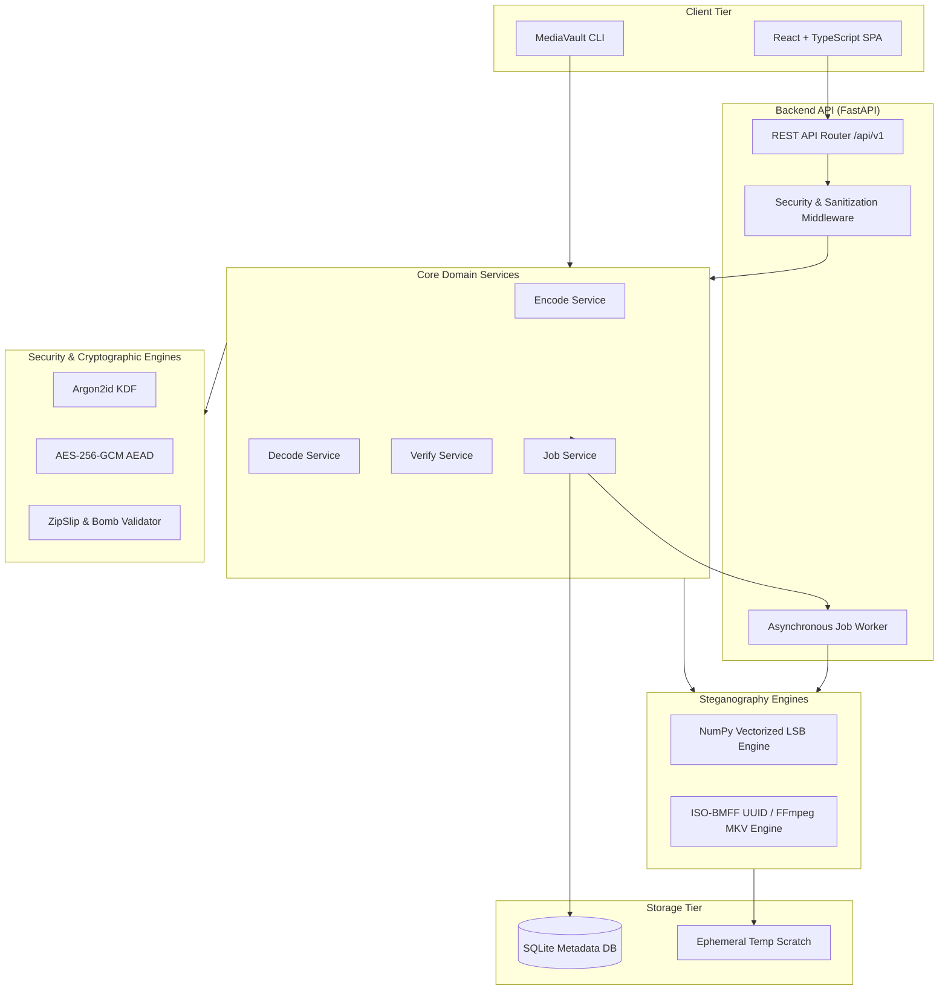
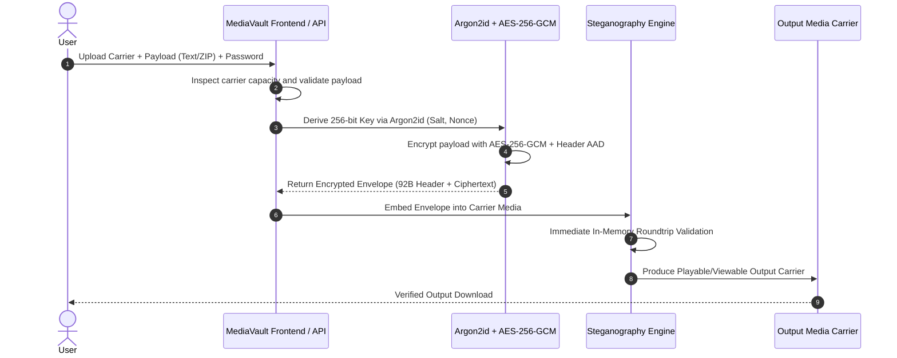
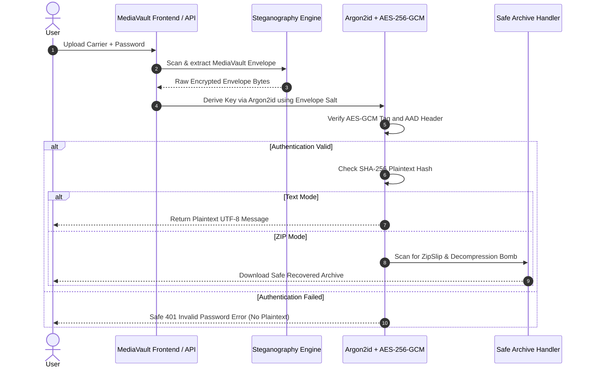

# MediaVault System Architecture

MediaVault is designed as a modular, secure steganography and cryptography platform.

---

## Architecture Diagram

---

## Core Workflows

### Workflow A: Hiding Data (Encoding)

### Workflow B: Recovering Data (Extraction)

---

## Subsystem Details

### 1. Image Steganography Engine
- Lossless format support: PNG (primary), BMP, TIFF.
- NumPy vectorized bit-plane modification on RGB channels (channels 0, 1, 2).
- Alpha channel (channel 3) left untouched to guarantee zero transparency distortion.
- Preamble marker: 8 bytes (`b"MVLT"` + 4-byte uint32 payload length).

### 2. Video Steganography Engine
- Container support:
  - **MP4 / MOV**: ISO/IEC 14496-12 standard `uuid` User-defined Extension Box. Preserves 100% video and audio streams via `-c copy` without re-encoding.
  - **MKV / WebM**: Native FFmpeg attachment stream (`-attach`).
- Every embedding operation executes an automated playback test via `ffmpeg -v error -i <file> -f null -` to verify normal playback before releasing output.

### 3. Archive Security Subsystem
- In-memory ZIP inspection before encryption and after extraction.
- Rejects directory traversal paths (`../`) and absolute paths (`/etc/`).
- Decompression bomb threshold: maximum 100 MB uncompressed and maximum 1,000 files.
